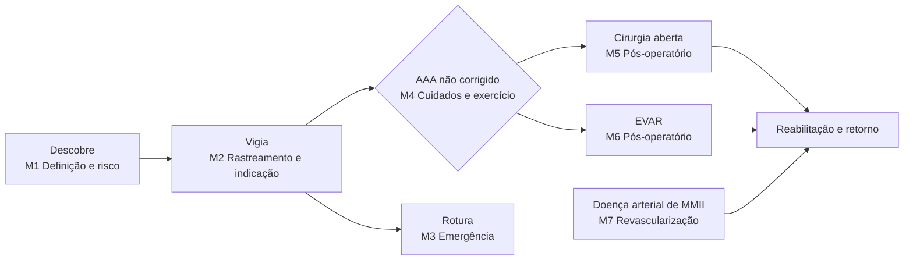

# Aneurisma de Aorta Abdominal e Reabilitação Vascular

**Material de estudo para graduação em Fisioterapia** · Fisioterapia nas Disfunções Angiológicas
Autora: Profa. Séres Souza · Atualizado em novembro de 2026 · Baseado nas diretrizes ESVS 2024, ESC 2024, ACC/AHA 2022, USPSTF 2019 e nos consensos ERAS/SVS

> Este material acompanha uma aula ativa em formato de *quebra-cabeça*: a turma se dividiu em 7 missões, cada grupo pesquisou uma parte e ensinou aos colegas. Aqui estão as 7 missões resolvidas, os casos clínicos com resolução e exercícios com gabarito comentado.

---

## O caminho do paciente

## Índice

| # | Conteúdo | Arquivo |
|---|---|---|
| 0 | Como estudar e ler uma diretriz | [`como-estudar.md`](como-estudar.md) |
| M1 | Definição, fatores de risco e história natural | [`missoes/m1-definicao-risco-historia-natural.md`](missoes/m1-definicao-risco-historia-natural.md) |
| M2 | Rastreamento e indicação cirúrgica | [`missoes/m2-rastreamento-indicacao-cirurgica.md`](missoes/m2-rastreamento-indicacao-cirurgica.md) |
| M3 | Quadro clínico da rotura | [`missoes/m3-rotura.md`](missoes/m3-rotura.md) |
| M4 | AAA não corrigido: cuidados e exercício resistido | [`missoes/m4-aaa-nao-corrigido-exercicio.md`](missoes/m4-aaa-nao-corrigido-exercicio.md) |
| M5 | Pós-operatório de cirurgia aberta | [`missoes/m5-pos-operatorio-cirurgia-aberta.md`](missoes/m5-pos-operatorio-cirurgia-aberta.md) |
| M6 | Pós-operatório de EVAR | [`missoes/m6-pos-operatorio-evar.md`](missoes/m6-pos-operatorio-evar.md) |
| M7 | Reabilitação após revascularização de membros inferiores | [`missoes/m7-revascularizacao-mmii.md`](missoes/m7-revascularizacao-mmii.md) |
| — | Casos clínicos (enunciados) | [`casos-clinicos/casos.md`](casos-clinicos/casos.md) |
| — | Casos clínicos (resolução comentada) | [`casos-clinicos/resolucoes.md`](casos-clinicos/resolucoes.md) |
| — | Exercícios | [`exercicios/exercicios.md`](exercicios/exercicios.md) |
| — | Gabarito comentado | [`exercicios/gabarito.md`](exercicios/gabarito.md) |
| — | Glossário | [`glossario.md`](glossario.md) |
| — | Referências primárias (com links) | [`referencias.md`](referencias.md) |

## Como usar

1. Leia [`como-estudar.md`](como-estudar.md) (10 minutos).
2. Estude as missões na ordem M1 → M7. Cada uma tem: o essencial, as perguntas da missão **resolvidas**, uma armadilha clínica e onde confirmar na fonte.
3. Resolva os [casos clínicos](casos-clinicos/casos.md) **antes** de abrir as resoluções.
4. Faça os [exercícios](exercicios/exercicios.md) e só então confira o [gabarito](exercicios/gabarito.md).

## Legenda de confiança

Cada afirmação importante traz uma etiqueta:

| Etiqueta | Significado |
|---|---|
| **[Diretriz]** | Está escrito em diretriz ou consenso de sociedade |
| **[Ensaio]** | Vem de ensaio clínico ou coorte, não de diretriz |
| **[Prática]** | Prática clínica corrente; varia entre serviços |
| **[Lacuna]** | Não há evidência sólida; desconfie de números exatos |

## Aviso

Material educacional para estudantes de graduação. Não substitui avaliação clínica individual nem os protocolos do serviço onde você atua. Diretrizes são atualizadas: confira sempre a versão mais recente nas [referências](referencias.md).

## Licença

[CC BY-NC-SA 4.0](LICENSE.md): pode copiar e adaptar para fins não comerciais, citando a autoria e mantendo a mesma licença.
